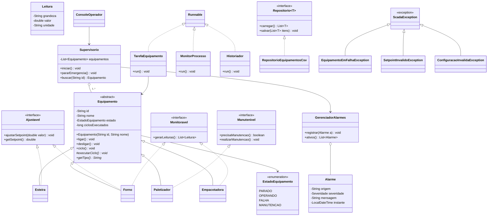

# Arquitetura — Mini-SCADA Industrial

> **Status: proposta inicial para discussão do grupo.** Nomes, classes e divisão podem mudar.

## O problema

Um sistema **SCADA** (*Supervisory Control and Data Acquisition*) supervisiona uma planta industrial:
mostra o estado das máquinas, lê sensores, gera alarmes quando algo sai do limite, permite ao operador
comandar os equipamentos e registra o histórico do processo.

O projeto simula uma **fábrica de biscoitos**: a massa é assada no forno, transportada pela esteira,
empacotada e paletizada para expedição. São 4 tipos de equipamento operando em paralelo,
supervisionados por um console de operador.

```
Forno ──▶ Esteira ──▶ Empacotadora ──▶ Paletizador ──▶ expedição
```

**Relevância ao curso:** supervisório, controle em malha fechada (forno com histerese), alarmes e
históricos de processo são conteúdo central de Engenharia de Controle e Automação.

## Visão geral

```
                      ┌──────────────────────────┐
  Operador ─────────▶ │  ConsoleOperador (menu)  │
                      └────────────┬─────────────┘
                                   │ comandos
                      ┌────────────▼─────────────┐        ┌──────────────────────┐
                      │      Supervisorio        │───────▶│  GerenciadorAlarmes  │
                      │ List<Equipamento>        │        └──────────────────────┘
                      └──┬──────────┬────────────┘
         1 thread por    │          │ threads de apoio
         equipamento     │          ├─ MonitorProcesso  (verifica limites → alarmes)
   ┌──────────┬──────────┼───────┐  └─ Historiador      (grava historico.csv)
   ▼          ▼          ▼       ▼
 Esteira   Forno   Paletizador  Empacotadora      ◀── herdam de Equipamento (abstrata)
```

## Pacotes

| Pacote | Conteúdo |
|---|---|
| `com.grupo8.scada.model` | `Equipamento` (abstrata), subclasses, `EstadoEquipamento`, `Leitura`, `Alarme`, `Severidade` |
| `com.grupo8.scada.model.interfaces` | `Ajustavel`, `Monitoravel`, `Manutenivel` |
| `com.grupo8.scada.service` | `Supervisorio`, `GerenciadorAlarmes` |
| `com.grupo8.scada.threads` | `TarefaEquipamento`, `MonitorProcesso`, `Historiador` |
| `com.grupo8.scada.persistence` | `Repositorio<T>` (interface), `RepositorioEquipamentosCsv`, `RegistradorCsv` |
| `com.grupo8.scada.exceptions` | `ScadaException` e subclasses |
| `com.grupo8.scada.ui` | `ConsoleOperador` |

## Como cada critério é atendido

| Critério | Onde |
|---|---|
| Classes | `Equipamento`, `Supervisorio`, `Alarme`, `Leitura`... com construtores que validam os dados |
| Herança | `Esteira`, `Forno`, `Paletizador`, `Empacotadora` `extends Equipamento`; exceções `extends ScadaException` |
| Polimorfismo | `Supervisorio` guarda `List<Equipamento>` e chama `executarCiclo()` / `gerarLeituras()` sem saber o tipo concreto; cada máquina reage do seu jeito |
| Classe abstrata | `Equipamento` — não existe "equipamento genérico"; `executarCiclo()` é abstrato |
| Interfaces | `Ajustavel` (setpoint: forno = temperatura, esteira = velocidade), `Monitoravel` (leituras de sensores), `Manutenivel` (ciclos até manutenção), `Repositorio<T>` (persistência) |
| Tratamento de erros | exceções próprias + `try/catch` nas threads, no menu e na leitura dos arquivos |
| Arquivos | `config/planta.csv` (equipamentos carregados ao iniciar), `historico.csv` e `alarmes.csv` (gravados durante a execução) |
| Threads | uma thread por equipamento + `MonitorProcesso` + `Historiador`; acesso compartilhado protegido (`synchronized` / coleções concorrentes) |
| UML | diagrama abaixo (rascunho) → versão final em `docs/uml/` |

## Regras de negócio (simulação)

- **Esteira** — `Ajustavel` (velocidade em m/s). Cada ciclo transporta biscoitos do forno até a empacotadora; acima da velocidade máxima → `SetpointInvalidoException`.
- **Forno** — `Ajustavel` + `Monitoravel`. Controle **on/off com histerese**: liga a resistência abaixo de `setpoint − h` e desliga acima de `setpoint + h`. Temperatura simulada sobe/desce a cada ciclo. Acima do limite de segurança → alarme crítico.
- **Paletizador** — `Manutenivel`. Empilha as caixas em paletes e conta ciclos; ao passar do limite entra em `MANUTENCAO` e para.
- **Empacotadora** — `Monitoravel` (estoque de filme/embalagem). Estoque baixo → alarme; acabou → `FALHA`.
- **Parada de emergência** — o operador para todas as threads de uma vez.

## UML (rascunho)



## Sugestão de divisão (cada um é dono de uma parte, mas todos devem entender o todo)

| Integrante | Parte | Critérios que vai defender com mais profundidade |
|---|---|---|
| A | `model` + `interfaces` (hierarquia de equipamentos, regras de simulação) | classes, herança, polimorfismo, abstrata, interfaces |
| B | `threads` + `service` (supervisório, monitor, historiador, concorrência) | threads, polimorfismo no supervisório |
| C | `persistence` + `exceptions` + `ui` + UML final | arquivos, tratamento de erros, UML |
